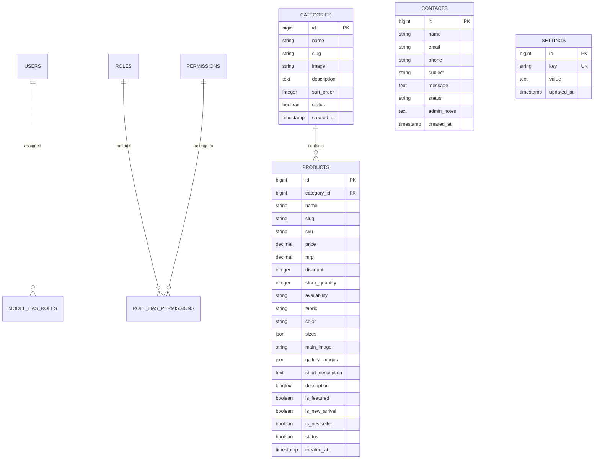

# 🌸 Sara's Boutique — Complete Project Architecture & Setup Documentation

---

## 📖 1. Project Overview & Executive Summary

**Sara's Boutique** is a full-stack luxury fashion and couture eCommerce web application built on **Laravel 11**, **MySQL**, and **Blade Architecture**. The system provides a customer-facing digital storefront with interactive shopping features alongside an administrative management suite tailored for fashion house operations.

### Key Highlights
* **Customer Storefront:** Luxury editorial aesthetics (*Cinzel* serif typography, champagne/gold accents, responsive layout, dynamic filtering, gallery zoom, size selectors, and direct WhatsApp concierge ordering).
* **Administrative Management Suite:** Clean Pearl-White & Boutique Gold UI/UX (`#f8f9fa` / `#ffffff` / `#c5a059`), Spatie Role-Based Access Control (RBAC), multi-image upload handling, real-time analytics widgets, inquiry management pipeline, and global store settings.
* **Database Driven:** MySQL database with categories, products, inquiries, settings, users, and permissions.
* **Tested & Reliable:** 100% passing automated test suite covering public routes, form submissions, security boundaries, and CRUD workflows.

---

## 🛠️ 2. Technology Stack & Prerequisites

| Layer | Technology / Package | Purpose |
| :--- | :--- | :--- |
| **Backend Framework** | Laravel 11.x | MVC architecture, routing, ORM, validation, auth middleware |
| **Language & Runtime** | PHP 8.2+ | Server-side execution |
| **Database** | MySQL 8.0+ | Relational data persistence & transactional integrity |
| **Frontend Templates** | Laravel Blade Engine | Server-side rendered views, reusable components & partials |
| **Styling & UI** | Vanilla CSS + Bootstrap 5.3.3 | Mobile-responsive grid, modals, and design tokens |
| **Icons & Fonts** | Bootstrap Icons + Google Fonts | *Cinzel*, *Plus Jakarta Sans*, *Poppins* |
| **Data Visualization**| Chart.js 4.4 | Real-time administrative trend graphs |
| **Authorization (RBAC)**| `spatie/laravel-permission` v6 | Fine-grained roles & permissions management |
| **Testing** | PHPUnit 11 | Unit & Feature automated test suites |

---

## 🗄️ 3. Database Architecture & Entity Relationships

The relational database is configured under MySQL (Database Name: `sara`).



### Table Breakdown
1. **`users`**: Administrative and staff members with hashed passwords, status flags, and timestamps.
2. **`roles` & `permissions`** *(Spatie)*: Defined roles (`Super Admin`, `Admin`, `Manager`, `Editor`, `Support`) and granular permissions (`view products`, `create products`, `delete users`, etc.).
3. **`categories`**: Catalog taxonomies (e.g., *Bridal Couture*, *Festive Silk*, *Pre-Stitched Sarees*, *Designer Kurtis*).
4. **`products`**: Item details, pricing, discounts, stock levels, fabric details, size arrays, main thumbnail, and multiple gallery images.
5. **`contacts`**: Customer inquiries submitted through the contact page with concierge inquiry status workflow (`New`, `In Progress`, `Resolved`, `Closed`) and internal staff notes.
6. **`settings`**: Dynamic key-value store for store brand name, tagline, helpline phone, WhatsApp concierge number, contact email, address, active promo code, and currency symbol.

---

## 🚀 4. Step-by-Step Installation & Setup Guide

Follow these steps to set up and run the application locally or on a production server.

### Step 4.1: Clone & Navigate to the Project
```bash
git clone <repository-url> saraweb
cd saraweb
```

### Step 4.2: Install Dependencies
```bash
composer install
```

### Step 4.3: Configure Environment Variables
Copy `.env.example` to `.env` if not already present:
```bash
cp .env.example .env
```
Generate an application encryption key:
```bash
php artisan key:generate
```

Configure your `.env` database settings:
```env
APP_NAME="Sara's Boutique"
APP_ENV=local
APP_KEY=base64:...
APP_DEBUG=true
APP_TIMEZONE=Asia/Kolkata
APP_URL=http://127.0.0.1:8000

DB_CONNECTION=mysql
DB_HOST=127.0.0.1
DB_PORT=3306
DB_DATABASE=sara
DB_USERNAME=root
DB_PASSWORD=
```

### Step 4.4: Run Database Migrations & Seeders
Create the `sara` database in MySQL, then execute:
```bash
php artisan migrate:fresh --seed
```
*This command creates all tables, seeds permissions, default roles, default admin accounts, boutique categories, and sample luxury products.*

### Step 4.5: Link Public Storage
Ensure uploaded images and media are accessible publicly:
```bash
php artisan storage:link
```

### Step 4.6: Start the Development Server
```bash
php artisan serve
```
The application will be accessible at:
* **Frontend:** [http://127.0.0.1:8000](http://127.0.0.1:8000)
* **Admin Login:** [http://127.0.0.1:8000/admin/login](http://127.0.0.1:8000/admin/login)

---

## 🔐 5. Default Admin Credentials & Access Control

### Login Credentials
| Account | Email | Password | Assigned Role |
| :--- | :--- | :--- | :--- |
| **Main Admin** | `admin@gmail.com` | `admin123` | `Super Admin` |
| **Developer Admin** | `developer@syscorp.in` | `password123` | `Super Admin` |

### Role Hierarchy & Permissions
* **`Super Admin`**: Full unrestricted access to all dashboard metrics, catalog CRUD, user management, role assignments, permissions, and system settings.
* **`Admin`**: Complete catalog, category, contact inquiry, and basic user management.
* **`Manager`**: Product CRUD, category CRUD, and contact status updates.
* **`Editor`**: Product and category management.
* **`Support`**: View and respond to customer concierge inquiries.

---

## 🗺️ 6. Application Route Map

### 🌐 Customer Frontend (Public)
| Method | Route Path | Route Name | Controller Action | Description |
| :--- | :--- | :--- | :--- | :--- |
| `GET` | `/` | `home` | `HomeController@index` | Hero banner, featured collections, new arrivals & reviews |
| `GET` | `/about` | `about` | `PageController@about` | Brand heritage, artisan craftsmanship, flagship store info |
| `GET` | `/collections` | `collections` | `ProductController@index` | Filterable catalog (by category, price, fabric, search) |
| `GET` | `/product/{slug}`| `product.show` | `ProductController@show` | Product gallery, size picker, fabric specs, WhatsApp order |
| `GET` | `/contact` | `contact` | `ContactController@create` | Contact details, store location, inquiry form |
| `POST`| `/contact` | `contact.store` | `ContactController@store` | Validates and persists customer inquiry |

### 🛡️ Administrative Suite (Protected by `auth` Middleware)
| Method | Route Path | Route Name | Controller Action | Description |
| :--- | :--- | :--- | :--- | :--- |
| `GET` | `/admin/login` | `admin.login` | `AuthController@showLoginForm` | Luxury admin login interface |
| `POST` | `/admin/login` | `admin.login.submit` | `AuthController@login` | Authenticates administrator credentials |
| `POST` | `/admin/logout`| `admin.logout` | `AuthController@logout` | Terminates admin session |
| `GET` | `/admin/dashboard` | `admin.dashboard` | `DashboardController@index` | Key stats, sales chart, recent products & inquiries |
| `RESOURCE`| `/admin/products` | `admin.products.*` | `ProductController` | Full CRUD for catalog items + image uploading |
| `RESOURCE`| `/admin/categories` | `admin.categories.*` | `CategoryController` | Full CRUD for boutique taxonomies |
| `GET/PUT/DEL`| `/admin/contacts` | `admin.contacts.*` | `ContactController` | Manage client inquiries, statuses & internal notes |
| `RESOURCE`| `/admin/users` | `admin.users.*` | `UserController` | Staff accounts & Spatie role assignment |
| `RESOURCE`| `/admin/roles` | `admin.roles.*` | `RoleController` | Role creation & permission grouping matrix |
| `RESOURCE`| `/admin/permissions` | `admin.permissions.*` | `PermissionController` | System permission definitions |
| `GET/POST/PUT`| `/admin/settings` | `admin.settings.*` | `SettingController` | Global store branding, phone, and promo config |

---

## 🎨 7. UI/UX Design System & Theme Alignment

The Admin Suite design has been unified with the **Sara's Boutique** customer-facing website theme:

### Color Tokens (Harmonized with Boutique Brand)
* **Body / Backdrop:** Soft Pearl Ivory `#fcfaf7` / `#ffffff`
* **Card Surfaces:** Crisp Pure White `#ffffff` with subtle depth shadow (`rgba(36, 0, 56, 0.04)`) and warm gold borders (`rgba(212, 175, 55, 0.25)`)
* **Brand Royal Purple:** `#3B005A` / `#240038` (Active sidebar items, user badges, headings)
* **Boutique Gold:** `#D4AF37` / `#B8860B` (Primary action buttons, active indicators, chart gradients)
* **Text Main:** `#1f2937` & `#240038` (Headings) / `#6b7280` (Muted)

### Typography (Exact Match with Website)
* **Headings:** `'Playfair Display', Georgia, serif` & `'Cinzel', serif`
* **Body & Interface:** `'Poppins', sans-serif` & `'Plus Jakarta Sans', sans-serif`
* **Luxury Script:** `'Caveat', cursive`

---

## 🧪 8. Automated Testing & Verification

The application includes automated test suites covering all major user journeys and backend operations:

```bash
php artisan test
```

### Covered Test Cases (14 Passing Tests, 53 Assertions)
1. **`Tests\Unit\ExampleTest`**: Basic assertion validation.
2. **`Tests\Feature\SaraBoutiqueTest`**:
   - Home page loads successfully (HTTP 200)
   - About page loads with brand story
   - Collections page loads with filters and search query parameters
   - Product details load dynamically with correct slug
   - Contact page loads and captures inquiries to database
   - Admin routes redirect unauthorized requests to login
   - Super admin authentication and dashboard access
3. **`Tests\Feature\AdminCrudTest`**:
   - Product creation, image upload, view, edit, and deletion
   - Category CRUD cycle
   - Contact inquiry status updates and internal concierge notes
   - Store settings update and persistence

---

## 📦 9. Maintenance & Useful Artisan Commands

| Task | Artisan Command |
| :--- | :--- |
| **Clear all caches** | `php artisan optimize:clear` |
| **Cache config & routes** | `php artisan config:cache && php artisan route:cache` |
| **Re-run seeders** | `php artisan db:seed` |
| **Run tests** | `php artisan test` |
| **Check route list** | `php artisan route:list` |
| **Start server** | `php artisan serve` |

---

*Documentation maintained for **Sara's Boutique** web application.*
